<a href="https://github.com/tatvamjain">
  
</a>

  
  
  

 



  



  


  <!-- TODO: wrap this card in <a href="YOUR-YOUTUBE-RAG-REPO-URL"> ... </a> -->
  
  <a href="https://github.com/tatvamjain/speech-Aware-Voting-Platform-for-Dysarthric-Users"></a>

  <a href="https://v0-railway-reservation-system-two.vercel.app"></a>
  <a href="https://github.com/tatvamjain/Fake-news-Detector"></a>

<code>ls ~/projects --more</code>

 

| repo | about |
|---|---|
| [railway-reservation](https://github.com/tatvamjain/railway-reservation) | Source for the live Railway Reservation app |
| [Railway-reservation-management-system](https://github.com/tatvamjain/Railway-reservation-management-system) | Earlier reservation management system project |
| [offer_personalization_ml](https://github.com/tatvamjain/offer_personalization_ml) | ML-driven offer personalization on customer interest data |
| [zerodha](https://github.com/tatvamjain/zerodha) | Zerodha landing page clone |

 



  



  


  
  

<!-- Contribution snake: run the "Generate snake" workflow once (Actions tab), then delete the two comment lines around this block to show it.

  <picture>
    <source media="(prefers-color-scheme: dark)" srcset="https://raw.githubusercontent.com/tatvamjain/tatvamjain/output/github-snake-dark.svg"/>
    <source media="(prefers-color-scheme: light)" srcset="https://raw.githubusercontent.com/tatvamjain/tatvamjain/output/github-snake.svg"/>
    
  </picture>

-->

 


<a href="mailto:tatvam.jain17@gmail.com">
  
</a>

